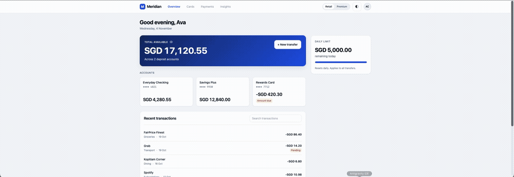
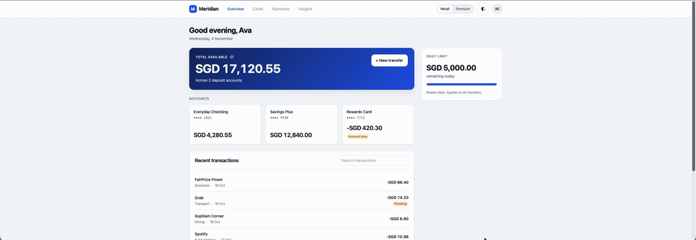
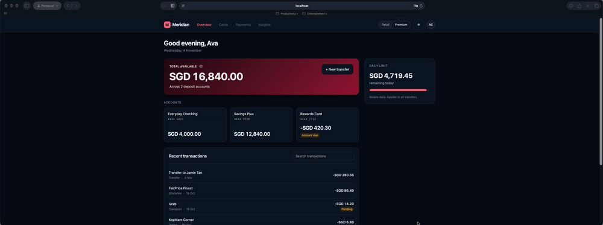

# Meridian Banking — Bilson Sim

- Deployed: [URL](https://fe-assignment-omega.vercel.app)
- Run locally: `npm install && npm run dev`

---

## Project structure

The application follows a clean feature-based architecture (feature-sliced, mirroring micro-frontend boundaries), ensuring strict separation of concerns, isolation between features, and maintainability:

```
src/
├── api/                          # Typed API layer (provided client + TanStack Query hooks)
│   ├── client.ts                 # Typed apiFetch helper (starter) + demo-scenario param propagation
│   ├── types.ts                  # Domain & API contract types (starter)
│   ├── queries.ts                # Read hooks (useCustomer, useAccounts, useTransactions, usePayees)
│   ├── mutations.ts              # Write hook (useCreateTransfer + query invalidation)
│   └── index.ts                  # Barrel export
│
├── schemas/                      # Single source of truth for validation
│   ├── transfer-schema.ts        # Zod: newRecipientSchema, recipientStepSchema, createAmountStepSchema
│   ├── transfer-schema.test.ts   # Unit tests for the validation rules
│   └── index.ts                  # Barrel export
│
├── lib/                          # Pure formatting utilities
│   ├── format.ts                 # formatMoney (en-SG) and formatShortDate (Asia/Singapore)
│   └── format.test.ts            # Unit tests for formatters
│
├── context/                      # React Context for client-only UI state
│   ├── theme-context.tsx         # ThemeProvider (light/dark + retail/premium)
│   └── index.ts                  # Barrel export
│
├── hooks/                        # Reusable logic hooks
│   ├── useTransactionSearch.ts   # Client-side transaction search & filter
│   ├── useFocusTrap.ts           # Modal focus containment + initial focus (a11y)
│   └── index.ts                  # Barrel export
│
├── types/                        # Local application UI types
│   └── index.ts                  # Theme, Segment, TransferStep, TransferFormData
│
├── common/                       # Design-system primitives (no business logic)
│   ├── button/                   # Accessible button (variants + sizes)
│   ├── skeleton/                 # Layout-preserving shimmer skeleton
│   ├── inline-error/             # Field error linked via aria-describedby
│   ├── empty-state/              # Zero-data state with optional action
│   └── index.ts                  # Barrel export
│
├── components/                   # Domain features (loosely coupled modules)
│   ├── header/                   # header.tsx, segment-switch.tsx, theme-toggle.tsx
│   ├── dashboard/                # balance-hero, account-card, transaction-list, daily-limit,
│   │                             #   search-input, dashboard-skeleton, dashboard-error, dashboard
│   ├── transfer/                 # transfer-dialog, stepper, step-recipient, step-amount,
│   │                             #   step-review, success-panel, payee-option
│   └── index.ts                  # Barrel export
│
├── dev/                          # Developer-only tooling (not a customer feature)
│   └── debug-menu/               # Switch mock scenarios; rendered only when ?debug=1 is set
│
├── mocks/                        # MSW fake backend
│   ├── handlers.ts               # Re-exports request handlers from mock-api/handlers.ts
│   ├── browser.ts                # setupWorker(...handlers) for the browser
│   └── scenario.ts               # localStorage scenario controller + the ?debug=1 gate
│
├── test/                         # Test setup (MSW Node server + DOM cleanup, resets per test)
│   └── setup.ts
│
├── App.tsx                       # Root shell: theme, header, dashboard, transfer, #transfer deep link
├── App.test.tsx                  # Behavioural integration tests (E4.1, E4.2, E4.3, T7, search, theme…)
├── main.tsx                      # Bootstrap: start MSW worker, then render inside QueryClientProvider
└── index.css                     # Global reset, focus rings, reduced motion, tabular-nums
```

---

## Decisions and trade-offs

### 1. Server state vs. UI state
- **Server state (TanStack Query):** All data from the mock API (`customer`, `accounts`, `transactions`, `payees`) is managed strictly through TanStack Query (`useQuery` and `useMutation`). No API responses are copied into local `useState` or global stores, eliminating synchronization bugs and cache drift.
- **Client UI state (Context + Local state):** UI state that lives purely in the browser—such as theme mode (`light`/`dark`), segment tier (`retail`/`premium`), and dialog visibility/active step—is managed using React Context and localized component state.
- **Derived data computed inline:** The dashboard's `Total available` is derived directly during render by summing deposit accounts (`type !== 'credit'`). It is never stored in separate state.

### 2. Forms and validation
- **Zod as single source of truth:** All validation rules (new recipient constraints, 8-digit account number regex, min/max amount, decimal precision, note length, and dynamic balance/limit checks) are defined once in `schemas/transfer-schema.ts`. The new-recipient rules live in exactly one schema (`newRecipientSchema`); the recipient step delegates to it via `safeParse` and re-maps issues onto the `recipient.*` form paths, so the rules are never re-implemented by hand.
- **Dynamic limit validation with React Hook Form:** Rather than hardcoding static balances, a dynamic resolver is configured for `StepAmount` that inspects the currently selected from-account and enforces real-time balance checks (`Amount can't be more than your available balance (SGD X,XXX.XX)`) and daily limit constraints (`This transfer exceeds your remaining daily limit (SGD X,XXX.XX)`).
- **Graceful API error propagation:** If server-side validation rejects a submission, the error is displayed in a prominent `role="alert"` banner while preserving user input so they can rectify and retry without losing their entered data.

### 3. Theming & anti-flash design
- **No-flash theme initialization:** An inline, zero-dependency `<script>` is placed in `index.html` head to inspect `localStorage` and `prefers-color-scheme` before the first paint, applying `data-theme` and `data-segment` attributes to `<html>` synchronously.
- **Strict design tokens:** All styling strictly references the CSS custom properties defined in `brief/design-tokens.css` (e.g., `var(--brand)`, `var(--surface)`, `var(--text)`, `var(--positive)`, `var(--negative)`). No hardcoded color values are used in components.

### 4. Client-side transaction search
- Filtered client-side across the 8 preloaded transactions. Since the dashboard displays recent transactions and the dataset is already present in client memory, filtering client-side avoids unnecessary network round-trips and provides instant, debounce-free feedback.

---

## Stretch goals & optional enhancements implemented

1. **Daily-limit Progress Bar:**
   - Visual progress indicator in the right rail showing real-time utilization of the customer's daily SGD 5,000 transfer limit.
2. **Balance-hide Toggle:**
   - Eye icon button on the `BalanceHero` card allowing users to mask their total available balance and all individual account balances with `SGD ****` for privacy in public spaces.
3. **`Discard this transfer?` Confirmation Modal:**
   - If the user has made partial inputs (selected a payee, typed amount, or note) and attempts to close the transfer wizard, a confirmation modal prompts them with `Keep editing` and `Discard` buttons, preventing accidental data loss.
4. **`#transfer` Deep Link:**
   - URL hash synchronization allowing direct navigation to the transfer dialog via `#transfer` on load or link share, with automatic cleanup upon closing.
5. **Evaluator Debug Menu** (lives in `src/dev/`, not shipped to normal users):
   - Collapsible toolbar (bottom-right) for switching between mock API scenarios (`scenario=error`, `scenario=empty`, `delay=2000`) without editing code. The choice is persisted to `localStorage` and the app reloads into it, so the simulated state is a clean full re-boot that behaves identically locally and on the deployed site.
   - **How to activate:** append `?debug=1` to the URL (e.g. `https://<your-app>/?debug=1`). The flag is persisted, so the 🛠 Debug button stays available across reloads until you append `?debug=0` to hide it again.
   - **Why `src/dev/`:** it's developer tooling, not a product feature, so it's separated from the customer-facing `src/components/` tree.
6. **Automated CI Workflow:**
   - GitHub Actions workflow (`.github/workflows/ci.yml`) enforcing `npm run check` (ESLint + TypeScript + Vitest) and `npm run build` on every push and pull request.

---

## Loading, empty and error states

1. **Dashboard Loading:**
   - **How it's handled:** `DashboardSkeleton` displays matching pulse skeletons for the balance hero, 3 account cards, transaction table rows, and daily limit card. This prevents layout jumps when data arrives.
   - **How to see it:** Refresh the page (responses take ~500ms by default), or add `?delay=2000` to the URL.

2. **Dashboard Error & Retry:**
   - **How it's handled:** If any query fails, `DashboardError` renders an alert screen with copy `"We couldn't load your dashboard."` and a `"Retry"` button that calls `refetch()` on all failed queries.
   - **How to see it:** Append `?scenario=error` to the request URL, or use the debug menu (`?debug=1`).

3. **Transaction Search Empty State:**
   - **How it's handled:** If a search query yields no matches, `EmptyState` displays `"No transactions match your search."` along with a `"Clear search"` button.
   - **How to see it:** Type a non-existent merchant (e.g. `xyz`) into the `Search transactions` box on the dashboard.

4. **Transfer Submission & Failure Handling:**
   - **How it's handled:** During mutation flight, the submit button is disabled and displays `"Sending…"`, preventing duplicate submissions. On failure (e.g., `#fail` test hook), the user remains on the Review step with all input intact and sees a red `role="alert"` banner: `"Something went wrong. Your money hasn't left your account. Try again."`
   - **How to see it:** Enter `#fail` in the transfer note and confirm the transfer.

---

## Tests

The test suite in `src/App.test.tsx` and `src/schemas/transfer-schema.test.ts` covers real user behaviour rather than implementation details:

1. **E4.1 — Amount over balance prevention:**
   - Opens the transfer flow, selects a payee, navigates to the amount step, and inputs `4500.00` (exceeding Everyday Checking's SGD 4,280.55 balance).
   - Asserts that the exact error `Amount can't be more than your available balance (SGD 4,280.55).` is displayed.
   - Asserts that no `POST /api/transfers` network request is ever dispatched.

2. **E4.2 — End-to-end successful transfer:**
   - Walks through all three transfer steps (Recipient → Amount → Review) with valid data.
   - Asserts that confirmation displays the `"Transfer sent"` panel with reference code.
   - Asserts that returning to the dashboard shows the updated balance (`4,160.55`) and refreshed transactions.

3. **E4.3 — Dashboard request failure and retry:**
   - Intercepts `/api/accounts` with a 500 error using MSW.
   - Verifies `"We couldn't load your dashboard."` and the `"Retry"` button are displayed.
   - Restores the handler, clicks `"Retry"`, and verifies the dashboard loads successfully.

4. **Additional Coverage:**
   - "Send to someone new" disclosure flow and 8-digit account number validation (incl. single-source schema reuse).
   - Transaction search filtering and clearing.
   - Light/dark theme toggle and retail/premium segment switching.
   - Transfer failure with `#fail` maintaining review step data integrity.

**On end-to-end testing (optional stretch goal):** the tests above are *behavioural integration* tests — they exercise full user flows through the real component tree with the mock API (MSW), in jsdom. They cover the same journeys a true end-to-end test would, but not in a real browser. A genuine E2E (Playwright/Cypress driving the built site in a browser) is listed under future iterations below; I left it out to avoid pulling a browser engine into this small app's toolchain, and because the integration suite already guards the critical flows.

---

## AI use

- **Which tools & what for:** Used AI for initial project scaffolding, formulating a phased implementation plan, and generating initial component skeletons.
- **Where human decisions overrode/fixed AI suggestions:**
  1. *React Hook Form discriminated unions:* An initial AI-generated schema used a discriminated union for the recipient step, which led to TypeScript type inference errors with React Hook Form's `FieldErrors`. Changed this to a flat object with a `.superRefine()` check (delegating to `newRecipientSchema`) so fields remain easily accessible and properly typed while keeping the rules single-sourced.
  2. *Dynamic balance resolver:* AI initially suggested a static schema instantiated once inside `useForm`. In a banking context where the user can toggle between checking and savings accounts within the same step, this would cause stale validation against the wrong account's balance. Overrode this with a memoized dynamic resolver that inspects `values.fromAccountId` on every validation run.
  3. *Testing Library JSDOM cleanup:* Vitest default configuration in the starter did not register automatic React Testing Library cleanup hooks across test boundaries, causing double-rendered components in subsequent tests. Added explicit `cleanup()` in `afterEach` inside `src/test/setup.ts`.

---

## Not done / known issues

- **Multiple currency accounts:** The mock API and brief specify single-currency SGD accounts; multi-currency conversions or cross-border remittance were deliberately left out of scope per §2.
- **Persistent segment on API:** The segment switch currently operates locally in `localStorage` per §3.4 without mutating the customer profile on the backend API.
- **Transfers/payees reset on refresh (by design):** The mock API is in-memory and re-seeds on reload, which the brief states is expected ("a page refresh resets it"). I deliberately did **not** add `localStorage` persistence for transfers or new recipients: it would require editing the handlers (discouraged by the brief) or mirroring server data into a client store, which drifts from the mock's own state. Theme/segment persist because they're pure client state the brief asks to remember. Within a session, transfers correctly update the balance, transaction list, and daily limit via TanStack Query invalidation.
- **Automated a11y checks not wired in:** The app follows the brief's explicit a11y requirements and the standard ARIA patterns, but there's no automated accessibility assertion in the suite. Adding `axe-core` (via `jest-axe` for structural checks, or `@axe-core/playwright` for contrast in a real browser) is listed under future iterations.
- **WCAG-AA contrast not formally audited:** Styling uses the provided design tokens and follows WCAG-AA patterns, but colour-contrast across all four theme × segment combinations has not been machine-verified with axe/DevTools.
- **Biometric authentication:** In a production mobile banking app, confirmation would ideally integrate WebAuthn/Passkeys before dispatching high-value transfers.

---

## Future iterations

If I were taking this beyond the take-home, in rough priority order:

1. **End-to-end test in a real browser** — add Playwright to drive the deployed build through the full transfer flow in Chromium/WebKit, complementing the jsdom integration suite and catching anything browser-specific (service worker, focus, layout).
2. **Automated accessibility checks** — wire `axe-core` into the suite: `jest-axe` for fast structural checks (labels/ARIA/roles) in the existing jsdom tests, and `@axe-core/playwright` in a real browser to also catch colour-contrast across the four theme × segment combinations (jsdom can't compute contrast). Prototyped this during development and removed it to keep the toolchain lean for the take-home, but it's the natural next step for a11y confidence.
3. **Real persistence behind the API** — if the mock were replaced by a real backend, transfers and new payees would persist server-side; the client already treats the API as the source of truth (TanStack Query), so this needs no client rearchitecting. A "save this recipient as a payee" action would slot in as a new mutation.
4. **Optimistic updates** — update the balance/transaction list immediately on `Confirm transfer` and roll back on error, instead of waiting for invalidation to refetch; snappier UX at the cost of rollback logic.
5. **Server-driven search & pagination** — move transaction search to the `q` API param with infinite scroll, so it works over the full history rather than the 8 loaded rows.
6. **Internationalisation & multi-currency** — externalise copy and support non-SGD accounts (both explicitly out of scope here).
7. **Design-system extraction** — promote `common/` primitives into a versioned package if this became one of several micro-frontends sharing a host.
8. **Account & transaction detail views** — deliberately omitted (transaction detail is listed out of scope in §2, and the accounts API exposes no fields beyond what the cards already show). With a richer API I'd let a transaction row or account card expand/open a detail panel (reference, running balance, receipt). Triggered by click/Enter — not hover — so it stays usable on touch and with a keyboard.

---

## Demo

**Transfer flow** — open → pick recipient → amount → review → success → the
dashboard balance updates:



**Dashboard** — balance hero, accounts, recent transactions, search, theme and
segment switching:



**Debug menu** (`?debug=1`) — switching the mock API into error / empty / slow
scenarios:



---

## Commands

```bash
npm run dev        # start the app (http://localhost:5173)
npm test           # run tests once
npm run check      # lint + typecheck + tests
npm run build      # production build into dist/
```
